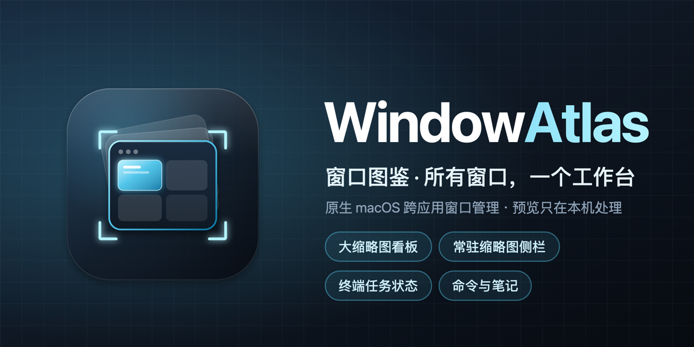

<p align="center">
  
</p>

<h1 align="center">WindowAtlas</h1>

<p align="center"><b>Every window, one workspace.</b><br>A native macOS window workspace that shows every window as a thumbnail and opens it with a double-click or Return.</p>

<!-- README-I18N:START -->
**English** | [简体中文](README.zh-CN.md)
<!-- README-I18N:END -->



## Why WindowAtlas?

When you run several Codex and Claude Code sessions, terminals, browsers and Finder windows at once, the one you need is always buried. Mission Control is temporary and title-only switchers make you guess. WindowAtlas lays out every open window like an atlas — grouped by app, as resizable thumbnails — so you recognize a window by what is in it, double-click or press Return, and you are back in the real window. Running sessions are never interrupted.

## Features

- **Thumbnail boards by app** — all windows, favorites, terminals, browsers and each app; grid, list, or list with a large preview; every app remembers its own layout, size and sort order.
- **Keyboard navigation** — click to select; double-click or press Return to open. Arrow keys select and scroll, with vertical grid navigation by row. Home/End jump to the first/last item; Esc clears selection.
- **Always-on sidebar** — a narrow thumbnail sidebar that follows you across Spaces and keeps working when the main board is closed.
- **Terminal task status** — optional: see whether a command or AI session is running, has recent output, is paused or idle in Terminal and iTerm2, even in the background. Only session IDs, TTYs and process metadata are read — never terminal contents.
- **Browser tabs** — optional: read every tab in Chrome, Edge and Safari, browse them per browser or together under All Windows, then search, switch or close; the current tab shows a live preview.
- **Drag and bulk arrange** — drag thumbnails or rows to reorder; Shift- or ⌥-select several windows to drag them together, move them to the top or to the bottom. Each section remembers its own order.
- **Multiple desktops and displays** — windows on other desktops (Spaces) are listed too and one click takes you there; placement works across displays.
- **Window placement** — right-click a window for a 3×3 grid, halves, center, fill or restore, with multi-display support.
- **Command library** — keep your Codex, Claude Code and custom-tool commands with purpose and examples; press ⌘K to search and copy.
- **Project notes** — Markdown notes with nested folders and sub-notes, one-click code copying, images, import from Markdown, JSON, code, Word, HTML and PDF, and backups to iCloud Drive, Google Drive, a local disk or an external drive.
- Light, dark and system appearance; English and Simplified Chinese.

## Requirements

1. macOS 14 or later.
2. A Mac with Apple silicon (M-series). Intel Macs are not supported yet.

## Install

### One-line install (Terminal)

```sh
curl -fsSL https://github.com/zerotoonex/WindowAtlas/releases/latest/download/install.sh | sh
```

The script checks your Mac, downloads the latest release, verifies its SHA-256 and that the app is signed with the official certificate, then installs it into Applications (an older copy is moved to the Trash). Files downloaded with `curl` carry no quarantine flag, so there is no Gatekeeper prompt — the app itself is still not notarized. Quit WindowAtlas before running it. [Read the script](scripts/install.sh) first if you like.

### DMG

1. Download `WindowAtlas-<version>-apple-silicon.dmg` from [Releases](https://github.com/zerotoonex/WindowAtlas/releases) and, optionally, verify it against the published SHA-256:

   ```sh
   shasum -a 256 ~/Downloads/WindowAtlas-<version>-apple-silicon.dmg
   ```

2. Open the DMG and drag **WindowAtlas** into **Applications**.
3. **First launch:** WindowAtlas is not notarized by Apple yet, so macOS blocks the first launch. Open *System Settings → Privacy & Security*, click **Open Anyway** next to “WindowAtlas was blocked”, and confirm. You only need to do this once per version. Please don't disable Gatekeeper.

The full guide — permissions, updating, backups, moving to a new Mac and uninstalling — is in [docs/INSTALL.md](docs/INSTALL.md) (Chinese, with an English quick guide at the end).

## First-time setup

WindowAtlas walks you through two system permissions on first launch:

| Permission | Why |
|---|---|
| Screen Recording | Shows thumbnails of your windows. Quit and reopen WindowAtlas after enabling it. |
| Accessibility | Brings the window you click to the front, and places, minimizes or closes windows. |
| Automation (optional) | Reads Chrome, Edge and Safari tabs and Terminal/iTerm2 session status when you turn those features on. |

If a switch is on but WindowAtlas still says it is not enabled, remove WindowAtlas from the list with “−” and add it again with “+”.

## Privacy and trust

- No account, no server, no analytics, no ads, no crash reporting, no auto-updater. The app makes no network requests of its own.
- Window previews are processed in memory and never written to disk or uploaded.
- Notes and commands stay in `~/Library/Application Support/WindowAtlas/`. Backups are written only to folders you choose; notes marked “Sensitive · No backup” are excluded.
- Read the full [privacy statement](docs/PRIVACY.md).

## Update and uninstall

- **Update:** quit WindowAtlas, replace it in Applications with the new version, and open it. Releases are signed with the same certificate, so your permissions normally carry over; if macOS asks again, re-enable them.
- **Uninstall:** move WindowAtlas to the Trash. To remove data, delete `~/Library/Application Support/WindowAtlas/` and `~/Library/Preferences/com.kaizaoji.windowatlas.plist`, and optionally run `tccutil reset ScreenCapture com.kaizaoji.windowatlas` (likewise for `Accessibility` and `AppleEvents`).

## Build from source

Requires the Xcode command-line tools (Swift 5.9 or later). There are no third-party dependencies.

```sh
swift test                 # run the test suite
zsh scripts/build.sh       # build dist/WindowAtlas.app (ad hoc signed)
zsh scripts/release.sh     # build, sign and package dist/WindowAtlas-<version>-apple-silicon.dmg
```

- `SIGN_IDENTITY="<identity>"` selects the signing identity. Official releases are signed with the maintainer's self-signed “WindowAtlas Release” certificate so permissions survive updates; ad hoc builds require re-granting permissions after every rebuild.
- With a Developer ID certificate, set `SIGN_IDENTITY="Developer ID Application: …"` and `NOTARY_PROFILE=<profile saved with xcrun notarytool store-credentials>` to sign with the hardened runtime and notarize.
- Brand assets live in `branding/` (SVG sources); regenerate everything with `zsh branding/tools/build.sh`.

### Project layout

| Path | Contents |
|---|---|
| `Sources/WindowAtlas/` | The app (SwiftUI + AppKit, ScreenCaptureKit, Accessibility) |
| `Tests/WindowAtlasTests/` | Unit and integration tests |
| `scripts/` | Build, release and test-fixture scripts |
| `branding/` | Logo, icons and usage guidelines |
| `docs/` | Install guide and privacy statement |

## Contributing

[Issues](https://github.com/zerotoonex/WindowAtlas/issues) and pull requests are welcome. Please run `swift test` before submitting, keep changes focused, and never include secrets or personal data in issues, notes or test fixtures.

By submitting a pull request, you agree that your contribution is licensed under the same MIT License as the project.

## License

WindowAtlas is open source under the [MIT License](LICENSE). Copyright © 2026 zerotoonex.

**In plain words** (the [LICENSE](LICENSE) file is the only legally binding text):

- **You may** use WindowAtlas for free — personally or commercially — and copy, modify, merge, publish, distribute, sublicense or sell copies of it.
- **You must** keep the copyright notice and the MIT license text in every copy or substantial portion you distribute, including modified versions and binaries.
- **No warranty:** the software is provided "as is". The authors are not liable for any claim, damage or data loss arising from its use. Keep your own backups of important notes.

**Scope:** the license covers everything in this repository — source code, tests, scripts, documentation and the brand assets in `branding/`. WindowAtlas has no third-party dependencies; it only uses Apple system frameworks, which are governed by Apple's own terms. Each release build includes the license at `WindowAtlas.app/Contents/Resources/LICENSE`, and the DMG includes `LICENSE.txt`.
