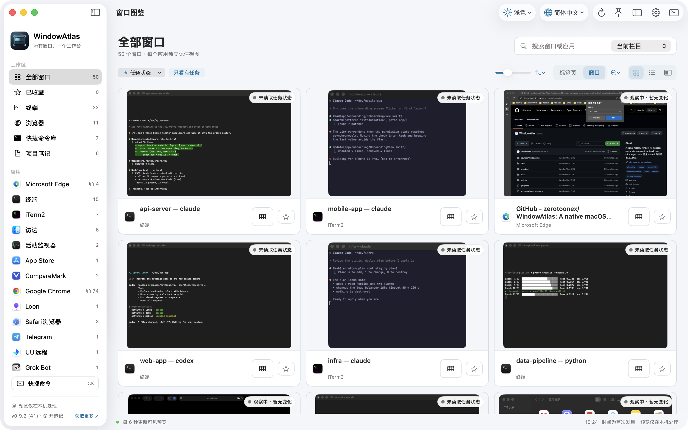
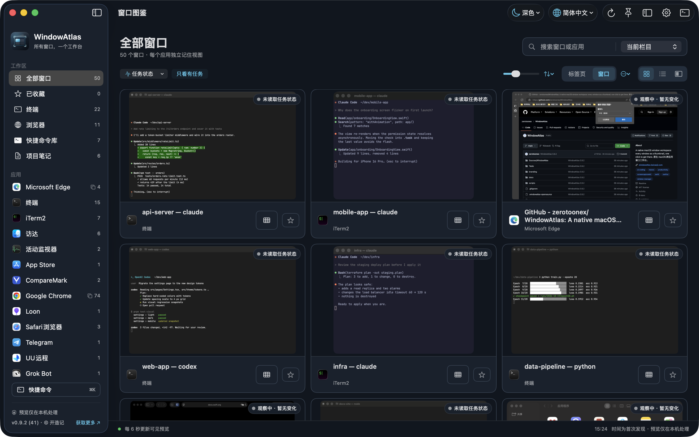
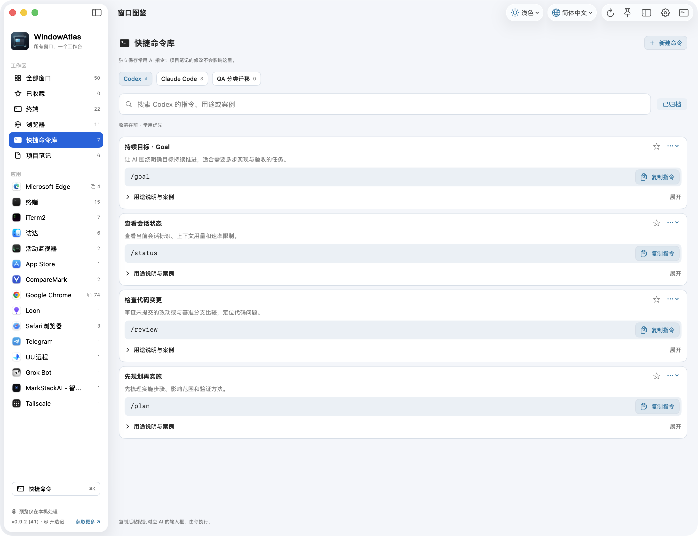
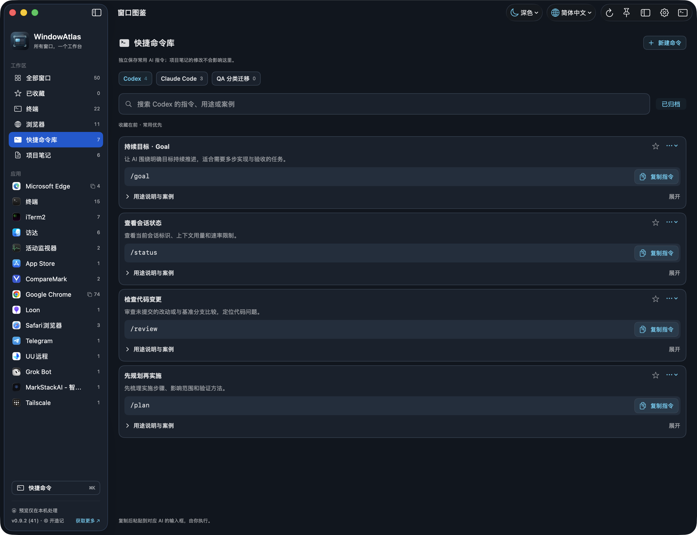

<p align="center">
  
</p>

<h1 align="center">窗口图鉴 WindowAtlas</h1>

<p align="center"><b>为 AI 并行编程打造的 macOS 窗口工作台。</b><br>十几个 Claude Code、Codex、终端和浏览器同时开着，也能一眼看到、一键回到你要的那个窗口。</p>

<p align="center">
  <a href="https://github.com/kaizaoji/WindowAtlas/releases/latest"></a>
  
  
  <a href="LICENSE"></a>
  <a href="https://windowatlas.kaizaoji.com"></a>
</p>

<!-- README-I18N:START -->
[English](README.md) | **简体中文**
<!-- README-I18N:END -->

<picture>
  <source media="(prefers-color-scheme: dark)" srcset="docs/screenshots/board-dark.png">
  
</picture>

## 为什么做窗口图鉴

AI 编程工具迭代飞快，我们的工作方式也变了：一个人同时让好几个 Claude Code、Codex 在不同项目里并行干活，再配上开发服务器、测试、浏览器、文档和 Finder。窗口越开越多，问题也随之而来：

- **找窗口慢**：⌘Tab 只按应用切换，同一个应用的十几个终端窗口只能靠猜；调度中心一松手就消失。
- **切错窗口**：终端标题长得都差不多，很容易把指令发到别的项目、或者打断正在跑的任务。
- **看不到进度**：后台的 AI 会话是还在跑、已经停下等你确认，还是早就结束了，得一个个点开看。

窗口图鉴就是为这种「多任务并行」的工作方式做的：把所有窗口按应用分门别类，用可调大小的实时缩略图摆在一个常驻工作台里。**看内容认出窗口，双击回到真实窗口**，正在运行的会话不会被打断。

## 为 AI 编程准备的能力

- **一眼认出每个会话**：终端、iTerm2、浏览器窗口都有实时缩略图，每 6 秒更新；靠内容而不是标题找窗口。
- **终端任务状态**（可选）：后台的 Terminal / iTerm2 也能显示命令或 AI 会话是否在运行、近期是否有输出、空闲了多久；支持「只看有任务」「任务优先」。只读取会话编号、TTY 与进程信息，**不读取终端内容、不执行命令**。
- **按你的节奏排列**：拖动缩略图调整顺序；Shift / ⌥ 多选后整组拖动、置顶或移到末尾，把正在推进的几个会话固定在最前面。每个栏目分别记住顺序。
- **⌘K 快捷命令库**：把常用的 Codex、Claude Code 指令（如 `/plan`、`/review`）连同用途和案例记下来，随时搜索复制。
- **项目笔记**：Markdown 记录提示词、上下文和踩坑记录，支持多级目录、代码块一键复制、图片与多处备份。

## 全部功能

- **按应用分类的缩略图看板**：全部窗口、收藏、终端、浏览器及各应用；缩略图、列表、列表与大预览三种排列，每个应用独立记住视图、尺寸与排序。
- **键盘导航**：单击选中，双击或回车打开；方向键选择并自动滚动，Home/End 跳首尾，Esc 清除选择。
- **常驻缩略图侧栏**：跨桌面空间显示，关掉主看板也能用。
- **浏览器标签页**（可选）：读取 Chrome、Edge、Safari 全部窗口里的标签页，可按浏览器或在「全部窗口」中汇总查看、搜索、切换、关闭；当前标签显示实时预览。
- **终端标签页**（可选）：Terminal、iTerm2 的每个标签（含分屏）单独列出，显示完整项目路径、正在运行的程序和 TTY，双击直达；不读终端内容，也不会从这里关闭会话。
- **一键排列窗口**：多选 2～9 个窗口（可跨应用），一键铺成网格、左右并排、上下堆叠或左侧主窗口；支持多显示器，排好的窗口会标出所在显示器。Chrome、Edge 的标签还能先拆成独立窗口再排列。
- **多桌面与多显示器**：其他桌面（Space）里的窗口同样列出，点击即切换过去；已关闭但系统仍残留的窗口自动隐藏。
- **窗口摆放与关闭**：右键窗口使用九宫格、半屏、居中、铺满、还原，支持多显示器；缩略图悬停显示关闭按钮，二次确认防误关。
- 浅色、深色与跟随系统外观；简体中文与 English 界面。

## 截图

| 浅色 | 深色 |
|---|---|
|  |  |
|  |  |

## 系统要求

1. macOS 14 或更高版本。
2. Apple 芯片（M 系列）Mac。暂不支持 Intel Mac。

## 安装

### 方式一：终端一键安装（推荐）

打开「终端」，粘贴并回车：

```sh
curl -fsSL https://github.com/kaizaoji/WindowAtlas/releases/latest/download/install.sh | sh
```

脚本会依次：检查是否为 Apple 芯片与 macOS 14+ → 下载最新版本 → **核对 SHA-256** → **校验应用签名是否为官方证书** → 安装到「应用程序」（已有旧版本时移到废纸篓，可恢复）→ 打开窗口图鉴。不使用管理员权限，可先[查看脚本内容](scripts/install.sh)。

- 安装指定版本：`curl -fsSL …/install.sh | WINDOWATLAS_VERSION=0.9.2 sh`
- 装到个人目录：`curl -fsSL …/install.sh | WINDOWATLAS_INSTALL_DIR="$HOME/Applications" sh`
- 运行前请先退出正在运行的窗口图鉴。

> 为什么终端安装不会弹出安全提示？macOS 只对浏览器等程序下载、带有「隔离标记」的文件做 Gatekeeper 检查，`curl` 下载的文件没有这个标记。应用本身仍**未经 Apple 公证**，脚本的哈希与签名校验就是为此而设。

### 方式二：下载 DMG

1. 从 [Releases](https://github.com/kaizaoji/WindowAtlas/releases/latest) 下载 `WindowAtlas-<版本>-apple-silicon.dmg`。建议核对发布页给出的 SHA-256：

   ```sh
   shasum -a 256 ~/Downloads/WindowAtlas-<版本>-apple-silicon.dmg
   ```

2. 双击打开 DMG，把 **WindowAtlas** 拖到旁边的「应用程序」文件夹，然后推出 DMG。
3. **首次打开会出现安全提示（正常现象）**：窗口图鉴是个人开发者开源发布的应用，暂未经过 Apple 公证（需要付费开发者账号）。第一次双击时 macOS 会提示 *「Apple 无法验证“WindowAtlas”是否包含可能危害 Mac 安全或泄漏隐私的恶意软件」*，只有「完成」和「移到废纸篓」两个按钮：
   1. 点「**完成**」关闭提示（不要点「移到废纸篓」）。
   2. 打开「**系统设置 → 隐私与安全性**」，向下滚动到「安全性」。
   3. 在「已阻止使用“WindowAtlas”」旁点「**仍要打开**」，输入登录密码确认，再点「打开」。

   每个新版本只需操作一次。请不要为此关闭 Gatekeeper。若提示「已损坏，无法打开」，请重新下载并核对 SHA-256。

完整说明（授权、升级、备份、换机与卸载）见 [docs/INSTALL.md](docs/INSTALL.md)。

## 首次设置

首次启动时，窗口图鉴会引导你完成两项系统授权：

| 授权 | 用途 |
|---|---|
| 屏幕录制 | 显示窗口缩略图；开启后需退出并重新打开窗口图鉴 |
| 辅助功能 | 把你点击的窗口切到前台，以及摆放、最小化、关闭窗口 |
| 自动化（可选） | 启用相应功能时读取 Chrome、Edge、Safari 标签页与 Terminal/iTerm2 会话状态 |

开关已打开但应用仍显示未开启时，在系统设置列表中用「−」移除 WindowAtlas，再用「+」重新添加。

## 隐私与信任

- 没有账号、没有服务器、没有统计、广告、崩溃上报或自动更新组件，应用自身不发起任何网络请求。
- 窗口预览只在内存中处理，不保存到磁盘、不上传。
- 笔记与命令保存在 `~/Library/Application Support/WindowAtlas/`；备份只写入你选择的文件夹，标记为「敏感 · 不备份」的笔记不会写入。
- 完整内容见 [隐私说明](docs/PRIVACY.md)。

## 升级与卸载

- **升级**：退出窗口图鉴，用新版本覆盖「应用程序」中的旧版本后打开。正式版本使用同一张证书签名，系统授权通常会保留；如 macOS 再次询问，重新开启即可。
- **卸载**：把「应用程序」中的 WindowAtlas 移到废纸篓。如需删除数据，删除 `~/Library/Application Support/WindowAtlas/` 和 `~/Library/Preferences/com.kaizaoji.windowatlas.plist`，并可执行 `tccutil reset ScreenCapture com.kaizaoji.windowatlas`（`Accessibility`、`AppleEvents` 同理）清除授权记录。

## 从源码构建

需要 Xcode 命令行工具（Swift 5.9 或更高），无第三方依赖。

```sh
swift test                 # 运行测试
zsh scripts/build.sh       # 构建 dist/WindowAtlas.app（ad hoc 签名）
zsh scripts/release.sh     # 构建、签名并打包 dist/WindowAtlas-<版本>-apple-silicon.dmg
```

- 用 `SIGN_IDENTITY="<身份>"` 指定签名身份。正式版本由维护者固定的自签名证书「WindowAtlas Release」签名，用户升级后授权可保留；ad hoc 构建每次重新构建都需重新授权。
- 有 Developer ID 证书时，设置 `SIGN_IDENTITY="Developer ID Application: …"` 与 `NOTARY_PROFILE=<用 xcrun notarytool store-credentials 保存的名称>`，即可启用 Hardened Runtime 并公证。
- 品牌资源在 `branding/`（SVG 源文件），用 `zsh branding/tools/build.sh` 重新生成。

### 目录结构

| 路径 | 内容 |
|---|---|
| `Sources/WindowAtlas/` | 应用源码（SwiftUI + AppKit、ScreenCaptureKit、辅助功能接口） |
| `Tests/WindowAtlasTests/` | 单元与集成测试 |
| `scripts/` | 构建、发布与测试夹具脚本 |
| `branding/` | Logo、图标与使用规范 |
| `docs/` | 安装说明与隐私说明 |

## 反馈与参与

窗口图鉴会持续迭代，非常欢迎你的反馈：

- **遇到问题**：提交 [Bug 反馈](https://github.com/kaizaoji/WindowAtlas/issues/new?template=bug_report.yml)，附上 macOS 版本、窗口图鉴版本（主窗口左下角）与复现步骤。
- **想要新功能**：提交 [功能建议](https://github.com/kaizaoji/WindowAtlas/issues/new?template=feature_request.yml)，尤其欢迎你在 AI 并行编程中遇到的窗口管理痛点。
- **贡献代码**：Fork 后提交 Pull Request。提交前请运行 `swift test`，保持改动聚焦。
- 觉得有用的话，给项目点一个 ⭐️，让更多做 AI 编程的人看到它。

请不要在 Issue、截图或测试数据中包含密钥、密码或其他个人信息。

提交 Pull Request 即表示你同意你的贡献以本项目相同的 MIT 许可证授权。

## 许可证

窗口图鉴以 [MIT 许可证](LICENSE) 开源。Copyright © 2026 开造记 kaizaoji。

**通俗说明**（具有法律效力的只有 [LICENSE](LICENSE) 英文原文）：

- **你可以**：免费用于个人或商业用途，复制、修改、合并、发布、分发、再许可或销售本软件的副本。
- **你需要**：在分发的每一份副本或重要部分中（包括修改版和编译后的程序）保留上述版权声明和 MIT 许可全文。
- **免责**：本软件按「原样」提供，不附带任何担保；作者不对使用本软件产生的任何索赔、损失或数据丢失承担责任。重要笔记请自行备份。

**适用范围**：许可覆盖本仓库全部内容，包括源码、测试、脚本、文档以及 `branding/` 中的品牌素材。窗口图鉴没有第三方依赖，只使用 Apple 系统框架（受 Apple 自身条款约束）。每个正式版本的 `WindowAtlas.app/Contents/Resources/LICENSE` 以及 DMG 中的 `LICENSE.txt` 都附带许可全文。

<details>
<summary>MIT 许可证中文参考译文（仅供理解，以英文原文为准）</summary>

版权所有 (c) 2026 开造记 kaizaoji

特此免费授予任何获得本软件及相关文档文件（以下简称「软件」）副本的人不受限制地处理本软件的权利，包括但不限于使用、复制、修改、合并、发布、分发、再许可和/或销售本软件副本的权利，并允许向其提供本软件的人这样做，但须符合以下条件：

上述版权声明和本许可声明应包含在本软件的所有副本或重要部分中。

本软件按「原样」提供，不附带任何明示或暗示的担保，包括但不限于对适销性、特定用途适用性和非侵权性的担保。在任何情况下，作者或版权持有人均不对因本软件或本软件的使用或其他交易而产生、引起或与之相关的任何索赔、损害或其他责任承担责任，无论是在合同诉讼、侵权诉讼或其他诉讼中。

</details>
