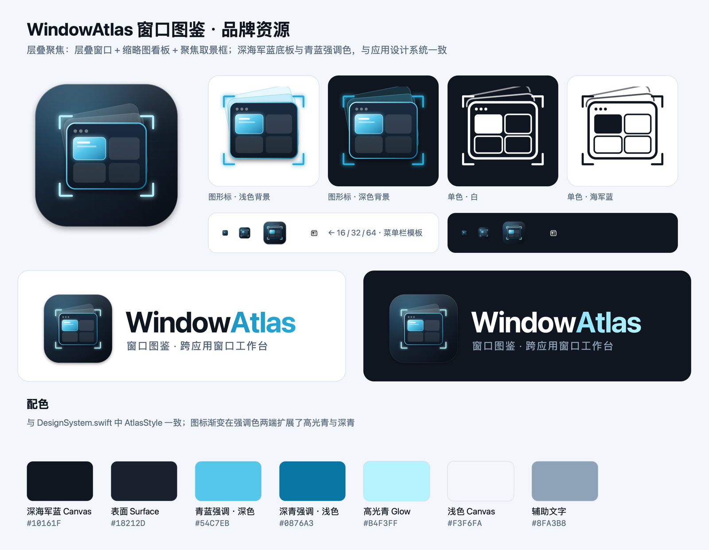

# WindowAtlas 窗口图鉴 · 品牌资源

本目录是项目唯一的品牌资源来源：logo、应用图标、各平台图标与使用规范。产品命名、口号、介绍文案与用语规范见 [BRAND-COPY.md](BRAND-COPY.md)。修改设计只改 `source/`，再运行一键脚本重新生成全部导出文件。



## 设计理念：层叠聚焦

- **层叠的窗口**：后方两张倾斜的卡片，代表桌面上互相遮挡、越堆越乱的窗口。
- **前景玻璃窗口 + 2×2 缩略图网格**：对应产品核心形态「Finder 式分类 + 大缩略图看板」。
- **发光的那一格**：当前要切换过去的窗口，「看内容、点一下、回到真实窗口」。
- **取景框角标**：聚焦与掌控，把所有窗口收进同一个视野。
- **材质**：深海军蓝圆角底板、极淡的科技网格底纹、顶部高光、玻璃质感与青蓝霓虹光晕；配色与应用内 `DesignSystem.swift` 的 `AtlasStyle` 一致。

## 目录结构

| 路径 | 内容 | 用途 |
|---|---|---|
| `source/app-icon.svg` | 主图标（1024 画布、824 圆角底板、含投影） | macOS 图标母版，64 像素及以上 |
| `source/app-icon-small.svg` | 小尺寸简化版（去掉圆点与远层卡片、加粗描边） | 16 / 32 像素 |
| `source/app-icon-flat.svg` | 满版无投影 | Windows .ico、Web 图标、应用内品牌标志 |
| `source/mark.svg` | 透明底图形标 | 文档、网页、深浅背景均可 |
| `source/mark-mono-white.svg` / `mark-mono-navy.svg` | 单色版 | 印刷、单色场景、水印 |
| `source/menubar-template.svg` | 菜单栏模板图标（18pt） | macOS 菜单栏，系统自动反色 |
| `source/logo-horizontal-{light,dark}.svg` | 横版组合标 | README、网站页头、文档封面 |
| `source/logo-vertical-{light,dark}.svg` | 竖版组合标 | 启动页、海报、方形位置 |
| `source/social-banner.svg` | 1280×640 横幅 | GitHub 社交预览、发布公告 |
| `macos/WindowAtlas.icns`、`macos/WindowAtlas.iconset/` | macOS 应用图标 | 构建脚本已接入 |
| `windows/WindowAtlas.ico` | 16/24/32/48/64/128/256 | Windows 或跨平台场景 |
| `web/` | `favicon.ico`、`favicon-32.png`、`apple-touch-icon-180.png`、`icon-192.png`、`icon-512.png` | 网站 / PWA |
| `png/` | 上述全部设计的 PNG 导出，组合标和横幅另有 `@2x` | 直接取用 |
| `preview/brand-sheet.png` | 品牌总览 | 快速查看与分享 |
| `tools/` | `build.sh`、`render.swift`、`ico.swift` | 一键重新生成 |

组合标与横幅的 SVG 已内嵌图标，单独拷走也能正常显示。SVG 中的文字使用系统字体（SF Pro / 苹方），在没有这些字体的设备上做印刷前，请先在设计软件中把文字转曲，或直接使用 PNG。

## 配色

| 名称 | 色值 | 用途 |
|---|---|---|
| 深海军蓝 Canvas | `#10161F` | 深色背景、单色版 |
| 表面 Surface | `#18212D` | 深色卡片 |
| 青蓝强调 · 深色 | `#54C7EB` | 主强调色（深色界面） |
| 深青强调 · 浅色 | `#0876A3` | 主强调色（浅色界面） |
| 高光青 Glow | `#B4F3FF` | 发光、取景框 |
| 浅色 Canvas | `#F3F6FA` | 浅色背景 |
| 辅助文字 | `#8FA3B8` | 深色背景上的副标题 |

字标「Window**Atlas**」中，Atlas 使用强调色渐变：浅色背景 `#0876A3 → #2AA9D6`，深色背景 `#54C7EB → #B4F3FF`。

## 使用规范

- **安全留白**：图形标四周至少留出图标宽度的 1/4；组合标左右至少留出一个图标宽度的 1/2。
- **最小尺寸**：应用图标不小于 16 像素（16/32 必须用 `app-icon-small`）；组合标宽度不小于 160 像素；菜单栏只用模板图标。
- **背景**：浅色背景用 `*-light` 组合标或 `mark-mono-navy`；深色背景用 `*-dark` 组合标或 `mark-mono-white`。彩色图形标深浅背景都可以用。
- **不要**：拉伸变形、改色或替换渐变、去掉取景框、给图标再加描边或投影、把图标放在高饱和或杂乱的图片背景上、旋转图标。

## 在应用中的接入（已完成）

- `scripts/build.sh` 把 `macos/WindowAtlas.icns` 拷为安装包内的 `AppIcon.icns`，Info.plist 设置了 `CFBundleIconFile`，程序坞、访达、「关于」窗口与系统设置的权限列表都显示新图标。
- `tools/build.sh` 会同时生成 `Sources/WindowAtlas/Resources/Brand/` 下的 `BrandIcon.png` 和 `BrandMenubarTemplate(@2x).png`。应用通过 `BrandAssets.swift` 加载：菜单栏图标、主窗口侧栏标题、常驻侧栏标题、首屏引导都已使用；资源缺失时回退原系统符号。

## 重新生成

```sh
zsh branding/tools/build.sh   # 重新生成 branding/ 下全部导出文件，并同步应用内资源
zsh scripts/build.sh          # 重新构建应用（会带上新图标）
```

只依赖 Xcode 命令行工具（`swiftc`）与系统自带的 `iconutil`、`base64`；SVG 用系统 WebKit 渲染，不需要安装任何第三方工具。macOS 可能缓存旧图标；覆盖安装后若程序坞仍显示旧图标，执行 `touch /Applications/WindowAtlas.app` 或重新登录即可。
